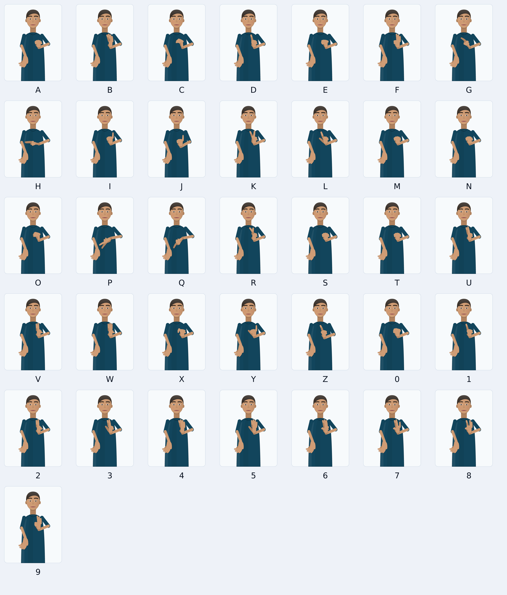
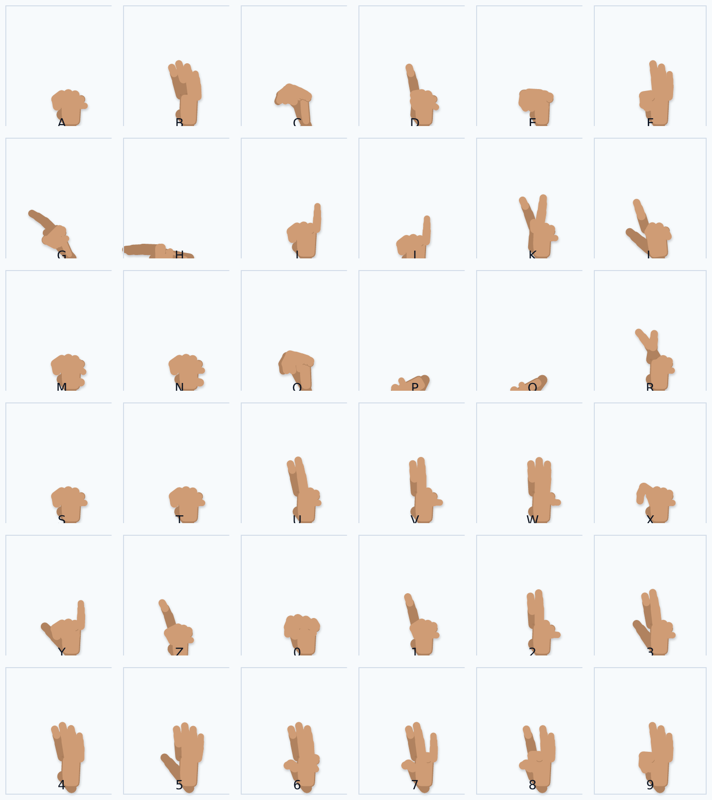

# SignBridge

**A two-way bridge between sign language and text.** Type text and an expressive avatar signs
it; sign to a camera and the app shows text (later phases).

This repository contains **Phase 1** of a ten-phase build: the application foundation and an
**expressive 2D avatar that fingerspells A–Z and 0–9** with a face that carries the grammar
(brows, eyes, cheeks, mouth), head movement and body posture.

> This tool assists communication and may make mistakes. It does not replace a certified
> interpreter for medical, legal, or emergency use.

---

## 1. What this build does (and does not do)

**Works today**

| Area | Status |
| --- | --- |
| Responsive app shell: Home, Text to Sign, Camera, Settings | ✅ |
| 2D SVG avatar: head, neck, shoulders, torso, both arms, both hands (21 landmarks each) | ✅ |
| Fingerspelling A–Z and 0–9 (one-handed manual alphabet) | ✅ draft data, needs signer review |
| Facial expressions: neutral, happy, yes/no question, wh-question, negative | ✅ switchable by buttons |
| Head nod / shake / tilt, torso lean, shoulder raise, movement speed | ✅ |
| Face-zoom mode, 21-landmark overlay, expression labels for learners | ✅ |
| Play / pause / replay / next / previous / loop / speed with current-word highlight | ✅ |
| High contrast mode, reduced motion, 5 avatar skin tones, left-handed mirroring | ✅ |
| English / Hindi / Marathi interface for navigation, actions and safety notices | ✅ partial |
| Entirely on-device, no accounts, no analytics, no network calls at runtime | ✅ |

**Not in this build** (by design — see the roadmap): whole-word vocabulary, grammar rules,
camera recognition, conversation mode, speech in/out, offline service worker, IndexedDB data
collection. The Camera screen is a **plan plus a local, privacy-gated camera test** — it does
not recognise anything.



*Every frame above is generated by the same rig at runtime — there are no image sequences.*

---

## 2. Quick start

```bash
npm install
npm run dev          # http://localhost:5173
```

Other scripts:

```bash
npm run build        # typecheck + production build → dist/
npm run preview      # serve the production build
npm run typecheck    # tsc --noEmit
npm run check:signs  # validate the sign dictionaries (see §7)
npm run check:text   # assert the text/grammar pipeline (normalise, sentence type, tokens)
npm run check:render # render every route headlessly and assert basic a11y
npm run check        # all four checks above
npm run render:avatar # regenerate docs/avatar-review/*.png (review sheets for signers)
```

Requirements: Node 20+ and a modern browser (Chrome/Edge/Safari/Firefox). No environment
variables, no API keys, no backend.

---

## 3. Project structure

```
.
├── index.html
├── public/                       # manifest + icon (PWA shell arrives in Phase 9)
├── scripts/
│   ├── validate-signs.mjs        # dictionary schema + coverage guard
│   ├── check-text.ts             # text/grammar regression checks
│   ├── ssr-smoke.tsx             # renders every route headlessly
│   └── render-avatar.tsx         # PNG review sheets for deaf signer review
├── docs/
│   ├── sign-format.md            # the language-agnostic sign JSON spec
│   └── avatar-review/            # generated review sheets (letters, expressions, idle)
└── src/
    ├── main.tsx, App.tsx         # entry + routes
    ├── index.css                 # design tokens, high contrast, component classes
    ├── types/sign.ts             # the sign format, in TypeScript
    ├── data/
    │   ├── index.ts              # dictionary loading, lookup, language registry
    │   └── signs/isl-fingerspelling.json   # 36 signs (A–Z, 0–9) — the data, not code
    ├── core/
    │   ├── rig/handRig.ts        # parametric hand → 21 MediaPipe landmarks
    │   ├── rig/body.ts           # stage geometry, signing space, 2-bone IK
    │   ├── rig/presets.ts        # rest poses + the five expression presets
    │   ├── rig/interpolate.ts    # easing + control-space interpolation
    │   ├── rig/compile.ts        # keyframes → per-frame rig state → AvatarFrame
    │   └── text/script.ts        # normalize → sentence type → tokens → playlist
    ├── hooks/useSignPlayer.ts    # clock, cross-fades, blink, playback API
    ├── components/
    │   ├── avatar/               # Avatar, AvatarStage, Head, Hand, Body
    │   ├── layout/AppShell.tsx   # nav (top + mobile tabs), skip link, safety notice
    │   └── ui/Icon.tsx
    ├── pages/                    # Home, TextToSign, Camera, Settings
    ├── store/settings.tsx        # persisted settings + i18n access
    └── i18n/strings.ts           # en / hi / mr message catalogue
```

---

## 4. How the avatar works

Sign language is not a sequence of pictures of hands. The rig is built so that every channel
that carries meaning is a **first-class, interpolatable parameter**.

### 4.1 Hands: a parametric rig, not hand-drawn frames

`src/core/rig/handRig.ts` builds each hand from **seven meaningful controls** — four finger
curls, thumb curl, thumb spread and palm orientation — via forward kinematics. The output is
**21 landmarks per hand in MediaPipe order** (`0 wrist · 1–4 thumb · 5–8 index · 9–12 middle ·
13–16 ring · 17–20 pinky`), which means:

- recorded camera landmarks (Phase 4+) can be compared with, or blended into, animated
  keyframes without a translation layer;
- the same numbers can drive a Three.js hand later;
- a fist looks like a fist: phalanges that point at the camera are foreshortened to nothing and
  are skipped, exactly as they are invisible on a real hand.

Arms are solved with **2-bone IK** from the shoulder to the wrist target, with an elbow
preference, so a hand can go anywhere in signing space without the arm stretching or breaking.

### 4.2 Face, head and body

`src/components/avatar/Head.tsx` renders brows (raise / furrow / asymmetry), eyelids (openness,
squint), gaze, cheeks (raise), mouth (open, width, smile, round, tongue) and nostrils. The head
rolls around a neck pivot and parallaxes with pitch/yaw; the torso leans and turns.

The five presets in `core/rig/presets.ts` change the **whole body**, and each one is labelled
in plain English on screen:

| Preset | What the learner is told |
| --- | --- |
| Neutral | Relaxed face and level head — no question or negation marker. |
| Happy | Smile with raised cheeks and slightly narrowed eyes. |
| Yes/no question | Eyebrows up, eyes wide, head tilted forward — the yes/no marker. |
| Wh-question | Brows pulled together and down, head tilted. |
| Negative | Brows down, head shaking side to side — no / not. |

### 4.3 Compile pipeline

```
SignEntry.keyframes ─ resolve (sparse overrides merged onto the sign's base pose)
                    ─ interpolate at t (per-segment easing, incl. spring)
                    ─ cross-fade from the previous sign (22% of each sign)
                    ─ add sentence-level non-manual marker + intensity + blink
                    ─ forward kinematics (hands) + 2-bone IK (arms)
                    ─ AvatarFrame { 21+21 landmarks, face, head, torso }
```

Interpolating **controls** rather than screen coordinates keeps the anatomy plausible: a finger
cannot pass through the palm and an arm cannot stretch between keyframes.

### 4.4 Playback

`useSignPlayer` owns a virtual clock (speed / loop aware), the cross-fade, and a blink
scheduler, and exposes `frame`, `index`, `progress` and transport actions. The animation loop
keeps running while paused so the avatar still blinks and the head keeps moving — no frozen
statue.

---

## 5. Text → sign

Phase 1 does the first two stages of the pipeline and stops honestly there:

1. **Normalise** — lowercase, strip punctuation, collapse whitespace.
2. **Classify the sentence** — statement / yes-no question / wh-question / negative / command
   (punctuation + a small wh-word and negation lexicon), and attach the matching non-manual
   marker.
3. **Map tokens** — a whole-word sign if the dictionary has one, otherwise **fingerspell**
   letter by letter; words that cannot be spelled are reported in the UI rather than dropped
   silently.

Phase 3 replaces step 3 with the editable grammar-rule engine (topic-comment order, question
marker at the end, negation with head shake) and a 100-word vocabulary. The rule hook already
exists in `core/text/script.ts` (`toSignTokens`), which is where those rules will live.

---

## 6. The sign format (language-agnostic JSON)

A sign is data, not code. Each entry records the handshape, location in signing space, movement,
palm orientation, non-manual markers, speed/size — plus review metadata. Full spec:
[`docs/sign-format.md`](docs/sign-format.md).

```jsonc
{
  "id": "isl-fs-a",
  "gloss": "A",
  "displayLabel": "A",
  "kind": "fingerspelling",      // fingerspelling | number | word | phrase | punctuation
  "languageTag": "isl",
  "durationMs": 520,
  "reviewStatus": "draft",       // draft | reviewed | supported
  "handshape": "Closed fist with the thumb resting upright against the side of the index finger",
  "location": "neutral-space",
  "movement": "Static hold with a small settle",
  "palmOrientation": "Palm faces inward, toward the body",
  "base": { "right": { "fingers": { "index": 1, "middle": 1, "ring": 1, "pinky": 1 },
                       "thumb": { "curl": 0.12, "spread": 0.32 },
                       "orientation": { "roll": 0, "yaw": -20 } } },
  "keyframes": [ { "t": 0, "right": { "position": { "x": 0.65, "y": 0.662 } } }, … ]
}
```

Adding **a sign** = append an entry. Adding **a sign language** = drop a JSON file in
`src/data/signs/` and register it in `src/data/index.ts`; nothing else changes.

---

## 7. Quality bar and review workflow

The project rule is that **every sign must be reviewed by a fluent deaf signer before release**,
and that accuracy is reported per sign and per sentence — never only overall.

This build therefore ships every entry as `reviewStatus: "draft"`, and the UI says so:

- `npm run check:signs` enforces the schema, unique ids/glosses, sorted keyframes, complete
  A–Z **and** 0–9 coverage, and requires anatomy metadata on every sign
  (`handshape`, `location`, `movement`, `palmOrientation`) for the reviewer.
- A sign may only be marked `supported` if it names its **reviewer** *and* carries per-sign
  accuracy data — the validator fails the build otherwise.
- `npm run render:avatar` writes the review sheets in [`docs/avatar-review/`](docs/avatar-review):
  the alphabet, hand close-ups, the five expressions and the idle pose. A signer can review them
  without opening the app.



---

## 8. Accessibility

- Mobile-first layout, controls ≥ 44 px, large hit areas, no hover-only actions.
- Semantic landmarks, exactly one `<h1>` per page, skip link, `aria-current` navigation,
  labelled icon buttons, `aria-live` announcements for the current sign, `role="switch"` toggles.
- **High contrast** mode (black canvas, yellow brand, thicker borders) independent of OS theme.
- **Reduced motion**: honours `prefers-reduced-motion` *and* an explicit in-app switch; the idle
  sway stops, transitions collapse. Nothing flashes, nothing strobes.
- **Captions for all audio**: Phase 1 has no audio at all; when speech arrives (Phase 8) every
  spoken output will be captioned on screen.
- Plain-English labels explain every non-manual marker ("Eyebrows up + head tilt = this is a
  yes/no question"), and the whole interface is designed to sit alongside Hindi and Marathi.
- Five avatar skin tones and left-handed mirroring, so the signer sees themselves in the avatar.

---

## 9. Privacy and ethics

- **On-device only.** No analytics, no accounts, no uploads, no runtime network calls.
- The camera page requires an **explicit consent checkbox**, shows a permanent *"Camera on ·
  on-device only"* indicator with a red dot, and stops the stream when you leave the page.
- No recording, no storage of video, ever, in this phase.
- The safety notice is shown on every page, and the Limitations section of the UI never presents
  an unreviewed sign or a low-confidence guess as certain.

---

## 10. Roadmap

| Phase | Scope | Status |
| --- | --- | --- |
| 1 | Foundation + expressive fingerspelling avatar | **this build** |
| 2 | Full avatar engine: richer hands, face morphs, body, space reference | next |
| 3 | Text-to-Sign v1: 100 words, grammar rules, short sentences | planned |
| 4 | Camera + landmark pipeline, alphabet/number recognition | planned |
| 5 | Single-word sign recognition (50–100 signs) | planned |
| 6 | 3–4 word sentence recognition with facial expressions | planned |
| 7 | Up to 8-word sentences + correction/feedback loop | planned |
| 8 | Conversation mode + speech in/out (with captions) | planned |
| 9 | Learning mode, consented data collection, offline PWA | planned |
| 10 | Testing with deaf users, accuracy hardening, vocabulary expansion | planned |

Scope guard for recognition (phases 4–7): **1-word signs and 3–4 word sentences from a fixed
vocabulary**, later up to 8 words. Never free-form long sentences.

---

## 11. Assumptions and open questions

These were decided to ship Phase 1; they are all easy to change, and the ones marked ❓ need a
decision from you (or from the deaf reviewers).

**Assumptions**

1. **Default language is Indian Sign Language (ISL)**; the JSON format and language registry are
   language-agnostic so ASL/BSL can be added as data.
2. **The fingerspelling alphabet is a one-handed manual alphabet** (the reference set most ISL
   teaching material shows). ISL is under-documented in public datasets compared with ASL, so
   every handshape is marked `draft` and the numerals `0–9` are explicitly flagged as an
   **ASL-style reference set** that must be replaced after signer review.
3. **Animation carries meaning through controls, not frames.** Keyframes express intent
   (curls, wrist targets, brow values), and the rig compiles them to 21 landmarks per hand.
4. **The avatar is stylised, not photoreal.** 2D SVG is the Phase 1 target; Three.js later.
5. **Settings live in `localStorage`** until IndexedDB lands in Phase 9.
6. **No backend in Phase 1.** The optional FastAPI service is not needed yet.
7. **Hands are drawn ~10% larger than life** so fingerspelling stays legible on a phone.

**Open questions** ❓

1. **Which fingerspelling alphabet should ISL use in your region?** Some ISL materials use
   variants for G/H/P/Q and for numerals. A deaf ISL signer's reference video would settle it.
2. **Two-handed signs**: OK to model BSL-style two-handed fingerspelling in Phase 2, or keep ISL
   one-handed only for now?
3. **Avatar style**: continue with this friendly flat 2D look, or move to a masked/neutral
   human avatar (less culturally specific, but more work)?
4. **Grammar rules**: do you want an editable rule file in Phase 3 (rules as data, editable in
   the UI), or a code-level ruleset with tests?
5. **Devanagari input**: should typed Marathi/Hindi transliterate to ISL glosses, or is English
   text input enough for the first releases?
6. **Data collection consent copy and storage** for Phase 9 needs a legal/privacy review before
   any signer records samples.

---

## 12. Known limitations

- The hand shapes are a **draft** interpretation and must be reviewed signer by signer; some
  pairs (M/N/A/S/T) differ mainly in thumb position and are hard to distinguish in 2D.
- Only fingerspelling is implemented; there is no whole-word vocabulary or grammar yet.
- No camera recognition, speech, conversation mode or offline caching yet.
- Hindi and Marathi cover navigation, actions and safety notices; longer explanations are
  English-only in this phase.
- Tested in Chrome/Safari/Firefox via the automated render check, not yet with deaf users —
  that is Phase 10 and a release gate.

---

## 13. Tech stack

React 19 · TypeScript 5.9 (strict) · Vite 7 · Tailwind CSS 4 · React Router 7 · SVG avatar ·
Node scripts for data validation and PNG review sheets. Next up (later phases): MediaPipe
Tasks, TensorFlow.js, Python/TensorFlow for training, IndexedDB, PWA, optional FastAPI.

No runtime dependencies beyond React + the router; the avatar is plain SVG generated by our own
rig, so it works offline today and will keep working inside a PWA shell in Phase 9.
