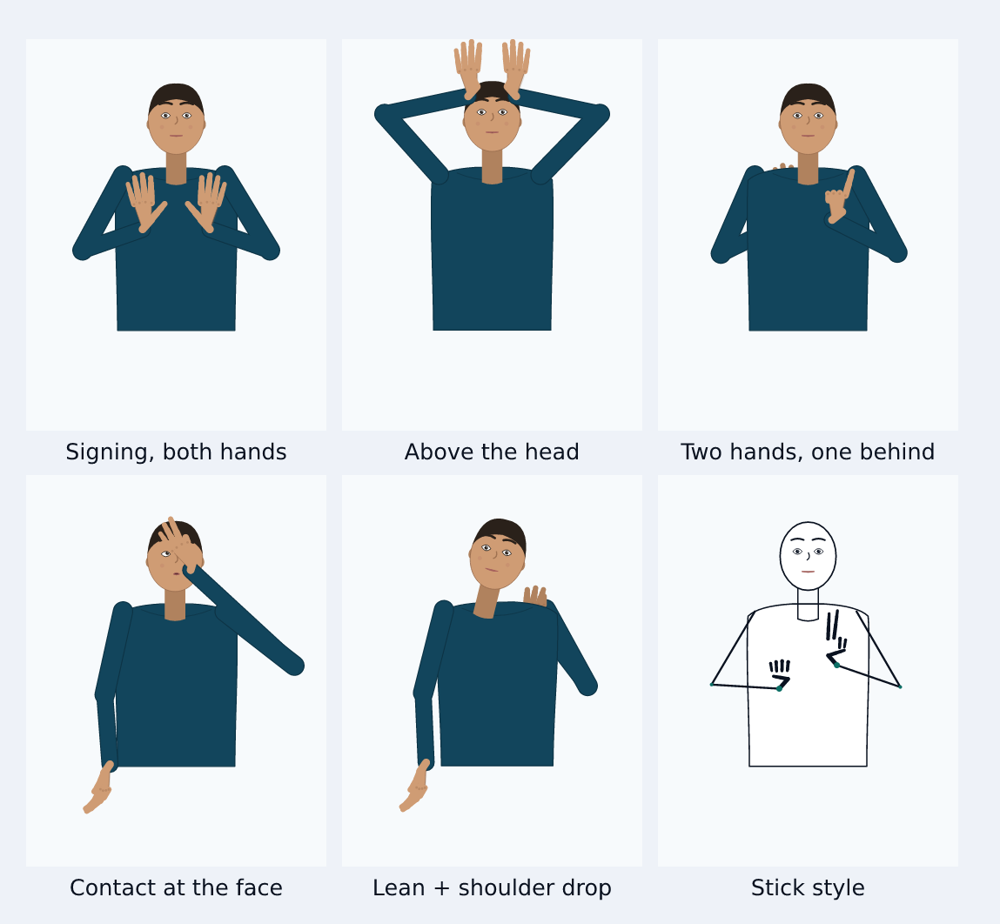

# SignBridge

**A two-way bridge between sign language and text.** Type text and an expressive 2D avatar
signs it; sign to a camera and the app shows text (later phases).

This repository contains **Phase 2** of a ten-phase build: the **avatar engine**.
Phase 1 was the app shell and a fingerspelling figure; Phase 2 turns that figure into a real
rig — a full skeleton with inverse kinematics, 71 handshapes, a 21-parameter face, ten
expressions, a five-track animation format, a timeline player, and a browser-based authoring
studio that exports those animations as JSON.

> This tool assists communication and may make mistakes. It does not replace a certified
> interpreter for medical, legal, or emergency use.

**Every animation in this build is a draft.** Every file carries
`"reviewed_by_deaf_signer": false`, and the UI says so wherever motion is shown. Nothing here
is a claim about correct Indian Sign Language (or any other sign language) until a fluent deaf
signer has reviewed and signed off on it.

---

## 1. What works today

| Area | Status |
| --- | --- |
| Seven screens: Home, Text to Sign, Demos, Handshape gallery, Sign Studio, Camera, Settings | ✅ |
| Rig: spine/torso, neck/head, two 2-bone arms with IK, two 21-landmark hands | ✅ |
| 71 handshape presets (32 basic, 36 alphabet, 3 classifier) inside anatomical joint limits | ✅ draft data |
| Face: 21 blend parameters, 10 named expressions, mouth-shape morphs (ah/ee/oo/pa) | ✅ |
| Head (nod, shake, tilt, gaze), body (lean, turn, shoulders, breathing) | ✅ |
| Five-track animation format + validator with readable errors | ✅ |
| Player: play/pause/replay/stop, scrub, speed, loop, view (full/hands/face), mirroring | ✅ |
| Transition blender between signs (200 ms, arced wrists, no snapping) | ✅ |
| Sign Studio: keyframe authoring, five tracks, live preview, JSON import/export, autosave | ✅ |
| Text → sign: fingerspelling A–Z and 0–9, max 32 characters, skipped characters surfaced | ✅ |
| Ten demo animations covering all five channels | ✅ draft data |
| Skin tones, outfits, high contrast, reduced motion, left-handed mirroring, 3 UI languages | ✅ partial |
| Entirely on-device: no accounts, no analytics, no network calls at runtime | ✅ |

**Not in this build** (by design — see the roadmap): a reviewed vocabulary, ISL grammar rules,
camera recognition, conversation mode, speech in/out, an offline service worker. The Camera
screen is a plan plus a **privacy-gated local camera test**; it recognises nothing.



*Every frame above is generated by the same rig at runtime — there are no image sequences.*

---

## 2. Quick start

```bash
npm install
npm run dev        # http://localhost:5173
```

| Command | What it does |
| --- | --- |
| `npm run dev` | Vite dev server on `0.0.0.0:5173` |
| `npm run build` | Type-check, then a production build into `dist/` |
| `npm run typecheck` | `tsc --noEmit` (strict, `noUncheckedIndexedAccess`) |
| `npm run check:animations` | Validate every animation file + the handshape library + the face parameters |
| `npm run check:render` | Render all seven routes with `react-dom/server` (catches render crashes) |
| `npm test` | 117 Vitest tests: rig, IK, interpolation, schema, transitions, queue, shipped content, DOM runtime |
| `npm run check` | All of the above, in order — the gate for a change |
| `npm run render:frames` | Re-render the review sheets in `docs/avatar-review/` (SVG → PNG via resvg) |

No headless browser is required: renders are verified by producing PNGs and looking at them,
and the DOM tests run in jsdom.

---

## 3. Project structure

```
src/
  core/
    rig/            anatomy · hand · handshapes · arm (IK) · pose · face · facePaths · render
    animation/      schema · interpolate · easing · compile · transition · queue
    text/           fingerspell (text → animation plan)
  components/
    avatar/         Avatar · Head · Torso · Hand · HandPreview · AvatarStage · AvatarPlayer
    studio/         Timeline (five lanes + playhead)
    layout/         AppShell (header, seven-item nav, mobile tab bar)
    ui/             Icon · Controls (Segmented, RangeField, Toggle, Fieldset)
  data/
    animations/     11 JSON files: 10 demos + the 36-glyph fingerspelling set
  pages/            Home · TextToSign · Demos · Gallery · Studio · Camera · Settings
  store/            settings (persisted preferences)
  i18n/             en · hi · mr strings (hi/mr partial)
scripts/            check-animations · ssr-smoke · render-frames
docs/               animation-format.md · phase-2-plan.md · avatar-review/ (generated sheets)
```

**Layering rule:** `core/` is pure TypeScript (no React, no DOM). `components/` renders.
`pages/` composes. Anything that decides where a joint goes lives in `core/rig`.

---

## 4. How the avatar works

### 4.1 Hands: angles in, landmarks out

A handshape is **joint angles only** — `{mcp, pip, dip, spread}` per finger plus the thumb's
`{cmc, mcp, ip, spread}`. Palm orientation, roll and wrist position are separate, so the same
handshape can be reused at any angle. Forward kinematics turns those angles into 21 landmarks
in MediaPipe order, which is what both the renderer and (later) the recogniser speak.

Every preset is clamped to anatomical limits before it is drawn, so a malformed file cannot
produce a backward-bending finger; `npm run check:animations` fails if any shipped preset sits
outside them.

### 4.2 Arms: inverse kinematics with a natural elbow

The animator says "put the wrist here". A two-bone solver places the elbow, with:

- **reach clamping** — the arm never stretches (and a Studio warning when a target is too far),
- **flexion limits** — the elbow cannot bend backwards,
- **a natural-elbow preference** — outside the torso, low, away from the head,
- **depth-aware folding** — a hand held in front of the body can be closer to the shoulder in
  the flat projection than a hand held at the side, because the forearm points at the viewer.

The elbow pick is *continuous*: an earlier version chose between the two mirror solutions with
an `if`, which teleported the elbow across the chest mid-animation. It now blends on a smooth
preference, so the worst elbow jump in any demo, at 2× speed, is under 40 px per frame (the
test suite enforces this).

### 4.3 Face

Twenty-one blend parameters (brows, lids, gaze, cheeks, nose, mouth shapes, lip press/purse,
tongue) drive pure geometry — no CSS, no emoji, no image swaps. Ten expressions are just named
points in that space: `neutral, happy, sad, angry, surprised, yesNoQuestion, whQuestion,
negation, emphasis, thinking`.

Non-manual overlay (an expression laid over any animation) is **grouped**: brows, eyes, cheeks
and nose only. The mouth belongs to the sign, so an overlay never erases a mouth morpheme —
unless the sign has no mouth track at all, in which case the overlay may use it too
(`overlayGroupsFor()` in `core/animation/compile.ts`).

### 4.4 Render pipeline

```
sample tracks → apply overlay → transition blend → clamp → mirror → build render pose → SVG
```

`RenderPose` is plain data (numbers in stage pixels), which is why the same code renders to the
DOM, to `react-dom/server`, and to PNG.

---

## 5. Text → sign (Phase 2 scope)

Fingerspelling only: text is upper-cased, unsupported characters are **listed** rather than
silently dropped, and the queue is capped at 32 characters. Expression and handedness are
controls on the page; there is no whole-word dictionary in this phase and no grammar mapping.
That is Phase 5.

---

## 6. The animation format

See **[docs/animation-format.md](docs/animation-format.md)** for the full specification. In
short: five tracks (right hand, left hand, face, head, body), keyframes at normalised times
`0..1`, per-keyframe easing, and a `meta` block that must state whether a deaf signer reviewed
it. Files are validated on load, on import into the Studio, and in CI.

---

## 7. Sign Studio

`/studio` is a working authoring tool, not a mock-up:

- five lanes on a timeline with draggable playhead and per-lane keyframe buttons,
- inspectors for handshape/palm/roll/wrist, face parameters, head and body,
- live preview at the current time, with rig warnings (out of reach, elbow through the body),
- JSON export (download or copy) and import with validation errors shown in plain language,
- autosave to IndexedDB (localStorage fallback) under `studio.draft.v1`.

Nothing in the Studio claims review status: exported files carry `reviewed_by_deaf_signer:
false` until a human changes it, and the UI keeps reminding you.

---

## 8. Quality bar

- **Content gate** (`check:animations`): every file validates, every referenced handshape
  exists, every face parameter visibly changes the drawing, the ten demos cover all five
  channels and are all marked unreviewed, and no keyframe pair moves the wrist far enough to
  read as a snap.
- **Render gate** (`check:render`): all seven routes render server-side with exactly one `<h1>`,
  the safety notice present, and `aria-label`s on the graphics.
- **Runtime gate** (`npm test`, jsdom): every page mounts with its effects running, the player
  ticks and pauses, and the camera cannot start before consent.
- **Rig gate** (`npm test`): joint limits, landmark count, mirroring, IK continuity, transition
  continuity, queue ordering, mouth masking, no per-frame pops at 0.5×/1×/2×.

---

## 9. Accessibility

- Transport buttons are real buttons with names; the player announces the current sign through
  `role="status"` + `aria-live="polite"`.
- Every graphic has a text alternative; the avatar SVG is labelled, not decorative.
- Focus is visible, the skip link is first in the DOM, and the mobile tab bar is five targets
  wide, not a scrolling strip.
- High-contrast mode, reduced motion (which also suppresses the idle breathing motion), and a
  1×–2× speed range.
- Interface in English, Hindi and Marathi — translations are **partial** and marked as such in
  the code, not silently English-only.

## 10. Privacy and ethics

- No accounts, no analytics, no network requests at runtime; the camera stream never leaves the
  device and is not recorded.
- Camera access requires an explicit consent checkbox, and the screen states plainly that
  recognition does not exist yet.
- The build never implies fluency it does not have: drafts are labelled drafts, demos are
  labelled demos, and the safety notice is on every screen.

## 11. Roadmap

| Phase | Scope |
| --- | --- |
| 1 ✅ | App foundation, first avatar, fingerspelling |
| 2 ✅ | Avatar engine: rig, IK, handshapes, face, animation format, player, Studio |
| 3 | Vocabulary: reviewed ISL signs, categories, search, favourites |
| 4 | Grammar: word order, non-manual markers, sentence planning |
| 5 | Camera → text: landmarks, windowing, on-device model |
| 6 | Conversation mode: both directions at once |
| 7 | Offline: service worker, pre-cached assets |
| 8 | Speech in/out, captions |
| 9 | Personalisation, learning mode |
| 10 | Field testing with deaf users and interpreters |

## 12. Known limitations

- **2D projection.** A folded arm in front of the chest is drawn with a foreshortened forearm
  rather than true depth, and an elbow can overlap the shirt silhouette. It is drawn in front
  of the body (correct for depth) and the rig only warns when the hand is actually behind.
- **Draft motion.** No animation has been reviewed by a deaf signer. Wrist paths, palm
  orientations and facial markers are plausible, not authoritative.
- **Fingerspelling is not sign language.** It is a bridge for names and short words.
- **No recognition.** The camera screen is a plan and a local preview.
- **Translations are partial** (English complete; Hindi and Marathi cover the main paths).
- **No offline cache yet**, so the app needs a network connection to load.

## 13. Tech stack

React 19 · TypeScript 5.9 (strict) · Vite 7 · Tailwind CSS 4 · React Router 7 · Vitest 5 ·
jsdom · @resvg/resvg-js (review renders). No UI kit, no animation library, no 3D engine —
the avatar is hand-written SVG driven by the same rig in every environment.
